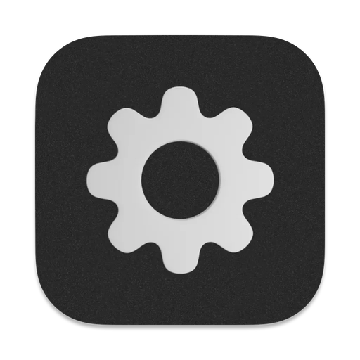

# Rig

<p align="center">
  
</p>

<p align="center">
  <strong>Your agent skills, in one place.</strong><br />
  A local-first macOS workspace for browsing, organizing, sharing,
  and restoring Agent Skills across Claude Code, Codex, and OpenCode.
</p>

<p align="center">
  <a href="https://github.com/builder-mafia/rig/releases/latest">Download for macOS</a>
  ·
  <a href="https://github.com/builder-mafia/rig/actions/workflows/ci.yml">CI</a>
  ·
  <a href="https://github.com/builder-mafia/rig/blob/main/LICENSE">GPL-3.0</a>
</p>

## Why Rig

Skills spread across agent folders and repositories. Rig brings those
`SKILL.md` files into a compact library while keeping them in their original
locations.

## What you can do

- **Browse by folder** — global skills appear first, followed by project
  accordions that include nested packages and custom skill folders.
- **Search instructions** — find skills by name, description, content, or path.
  Matching folders open automatically while searching.
- **Hide only in Rig** — hide individual skills, folders, or provider sources without
  moving files or changing agent discovery. Open **Hidden** to show them again.
- **Read and share** — inspect rendered instructions, source, and file details;
  right-click to copy instructions or share an installation prompt.
- **Copy between folders** — select skills and use Command/Ctrl+C and V, or drag
  them onto a project or folder. Supporting files are copied too; existing skills
  are preserved with a new `-copy` name when necessary.
- **Language and appearance** — choose English or Korean and light, dark, or
  system appearance in Settings. Preferences stay on this device.
- **Manage in batches** — Command/Ctrl-click or Shift-click to select multiple
  skills, then share, hide, or delete them together.
- **Restore existing versions** — inspect saved snapshots and readable diffs.
- **Switch projects** — add folders beside **All skills** to browse a project.

## Local by default

Rig reads skill files on your Mac. Hidden skills are stored as a local Rig
preference; their files and availability to agents do not change. Files moved
into `.archive` by older versions remain recoverable from **Hidden** using
**Restore file**. Restoring those legacy files moves them back to their original
folders; new hide/show actions never move files.

## Get started

### 1. Install Rig

1. Download the latest signed and notarized Apple Silicon build from
   [GitHub Releases](https://github.com/builder-mafia/rig/releases/latest).
2. Open the `.dmg` and drag **Rig** into Applications.
3. Launch Rig. Global skill folders are discovered automatically.
4. Use **Add project** in the header when you want a repository-specific view.

Rig checks GitHub Releases for signed application updates.

### 2. Choose skill sources

Open **Settings → Skill sources** to choose which providers appear in Rig.
No usage-tracking integration is needed.

## Skill locations

Rig discovers these global locations automatically:

| Provider | Global skill directory |
| --- | --- |
| Codex | `~/.codex/skills`, `~/.agents/skills` |
| Claude Code | `~/.claude/skills` |
| OpenCode | `~/.config/opencode/skills` |
| Hermes | `~/.hermes/skills` |
| Cursor | `~/.cursor/skills` |

Imported repositories are scanned recursively for `SKILL.md`, including nested
packages and custom skill folders. Dependency, build, Git, and archive folders
are excluded from the active library.
Removing a repository from Rig removes only the saved scope; it does not delete
the repository or its skill files.

## Development

### Requirements

- macOS
- Node.js 20+
- pnpm 9.6
- Rust stable
- Xcode Command Line Tools

### Run locally

```sh
pnpm install

# Tauri desktop app at localhost:3000
pnpm dev:app

# Website and docs at localhost:3001
pnpm dev:doc
```

### Verify changes

```sh
pnpm --filter @allin/ui build
pnpm --filter @allin/utils build
pnpm --filter desktop-app check-ts
pnpm --filter desktop-app test
pnpm --filter desktop-app lint
pnpm --filter docs build
cargo test --manifest-path apps/rig/src-tauri/Cargo.toml
```

Pull requests and pushes to `main` run the same web and Rust checks in GitHub
Actions. Vercel deploys the website after changes reach `main`.

## Releases

Tagged releases are built for Apple Silicon, signed with a Developer ID
certificate, notarized by Apple, and published with Tauri updater artifacts.
Versions use the Korea Standard Time release date in `YY.MDD.R` format; for
example, `v26.804.1` is the first release made on August 4, 2026.
See [the release guide](.github/RELEASE.md) for the required secrets and version
workflow.

## License

Rig is licensed under [GPL-3.0](LICENSE).
